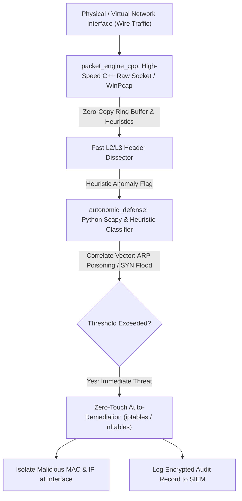

# IronTunnel — Zero-Trust Autonomic Network Defense & Low-Level Packet Engine

**IronTunnel** is an integrated zero-trust network defense platform unifying **low-level C++ kernel/NIC packet interception** with an **autonomous Python self-healing firewall orchestration daemon**.

Built to bridge the performance gap between wire-speed raw packet processing and real-time heuristic threat neutralization, IronTunnel detects and mitigates in-flight attacks (MITM ARP poisonings, SYN flood resource exhaustion, rogue DHCP gateways, DNS hijackings, and stealth port scans) autonomously without human intervention.

---

## 1. Unified Architecture

```
IronTunnel/
├── packet_engine_cpp/            # High-Throughput Wire-Speed Packet Interceptor (C++)
│   ├── include/                  # Packet headers, socket definitions, and HUD interfaces
│   ├── src/                      # Raw WinPcap / Linux socket sniffer and parser
│   ├── CMakeLists.txt            # Cross-platform CMake build configuration
│   ├── Makefile                  # POSIX build target
│   └── main.cpp                  # Native desktop monitor entrypoint
│
├── autonomic_defense/            # Autonomous Threat Detection & Self-Healing Remediation (Python)
│   ├── src/                      # Scapy flow analyzer, anomaly ML models, and remediation daemon
│   ├── scripts/                  # Network configuration and setup automation
│   ├── tests/                    # Automated unit and integration test suite
│   ├── requirements.txt          # Python dependencies
│   └── pytest.ini                # Pytest configuration
│
└── README.md                     # Master architecture documentation
```

---

## 2. Technical Thought Process & Architectural Rationale

### The Core Problem Statement
Traditional network security postures suffer from a critical operational divide:
1. **Sniffers & Packet Monitors** (e.g. Wireshark, standard desktop monitors) provide deep visibility into packet headers, but they are completely **passive**—they observe malicious behavior while an attacker compromises the perimeter.
2. **Enterprise SIEMs & Firewalls** can block traffic, but their alert-to-remediation loop (MTTC: Mean Time To Contain) frequently exceeds 15 to 45 minutes because human SOC analysts must manually approve quarantine rules.

### The IronTunnel Solution: Dual-Engine Convergence


### Key Design Decisions
- **Why C++ for the Packet Engine?** Wire-speed network analysis requires minimal garbage collection overhead. IronTunnel's C++ core leverages native OS socket APIs (`AF_PACKET` on Linux, WinPcap/Npcap on Windows) to capture and parse packet frames with microsecond latency.
- **Why Python for Autonomic Self-Healing?** Heuristic pattern correlation, flexible socket routing, and dynamic firewall policy synthesis benefit from Python's rich ecosystem (Scapy, AsyncIO).
- **Zero-Touch Autonomic Remediation:** The self-healing daemon doesn't just log attacks; it actively synthesizes and applies targeted firewall rules (`iptables -A INPUT -s <attacker_ip> -j DROP`) within milliseconds of signature verification.

---

## 3. Threat Mitigation Capabilities

| Threat Vector | Detection Mechanism | Autonomic Self-Healing Action |
| :--- | :--- | :--- |
| **ARP Cache Poisoning (MITM)** | Dual IP-to-MAC mapping conflict detection in ARP replies | Flushes infected ARP cache entry; static binding enforced; attacker MAC dropped. |
| **SYN Flood DoS Attack** | TCP handshake half-open connection ratio monitoring | Enables SYN cookies; drops attacker IP at packet filter layer. |
| **Rogue DHCP Gateway** | Detects DHCP Offer packets originating from unauthorized MAC addresses | Blocks rogue DHCP server port (UDP 67/68); broadcasts alert to network. |
| **Stealth SYN / FIN Port Scans** | Sliding-window connection attempt dispersion tracking | Temporarily blacklists scanning IP for 3600 seconds. |
| **DNS Spoofing / Redirection** | Query ID validation and authoritative NS response cross-referencing | Reverts resolver cache to hardened upstream DNS-over-HTTPS. |

---

## 4. Build & Installation Guide

### Building the C++ Packet Engine
```bash
cd Cybersecurity-and-Systems/IronTunnel/packet_engine_cpp
cmake -B build
cmake --build build
```

### Running the Autonomic Self-Healing Daemon
```bash
cd Cybersecurity-and-Systems/IronTunnel/autonomic_defense
python3 -m venv venv
source venv/bin/activate
pip install -r requirements.txt
python3 src/main.py
```
